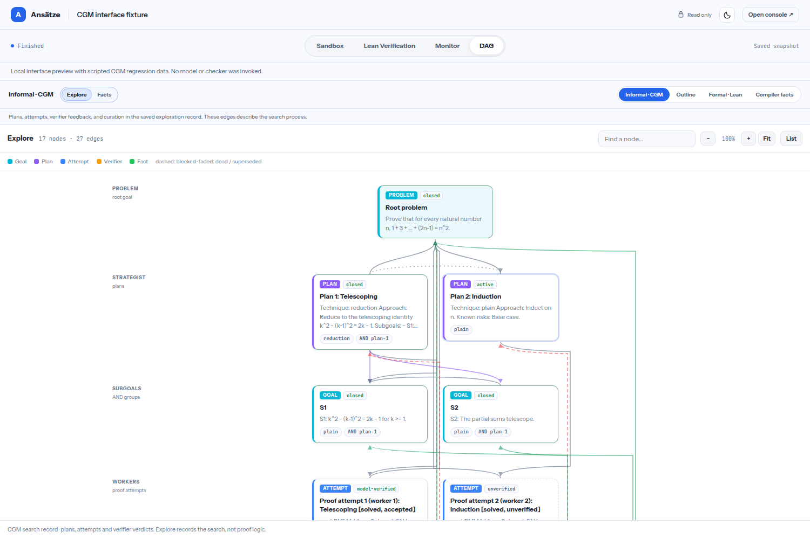
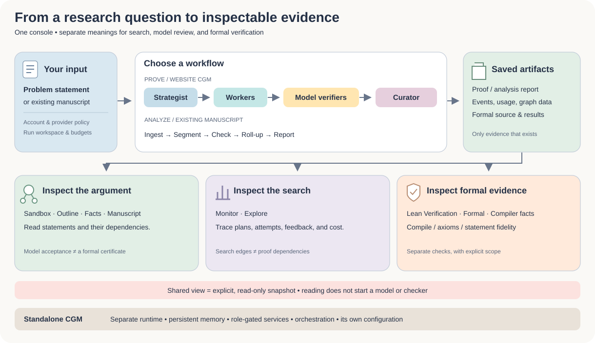

<p align="center">
  
</p>

<h1 align="center">Ansätze</h1>
<p align="center"><strong>A workspace for mathematical research, proof exploration, and evidence you can inspect.</strong></p>

<p align="center">
  <strong>English</strong> · <a href="README.zh-CN.md">简体中文</a> · <a href="README.fr.md">Français</a>
</p>
<p align="center">
  <a href="https://ansatze.ai/"> ansatze.ai</a> &nbsp;·&nbsp;
  <a href="https://github.com/ericjiang18/agent_monitor_math"> Source on GitHub</a> &nbsp;·&nbsp;
  <a href="https://ansatze.ai/quickstart">User guide</a> &nbsp;·&nbsp;
  <a href="CONTRIBUTING.md">Contribute</a>
</p>

<p align="center">
  <a href="https://github.com/ericjiang18/agent_monitor_math/actions/workflows/ci.yml"></a>
</p>

Ansätze brings **Continual Graph Memory (CGM)**, mathematical agent monitoring, manuscript analysis, and Lean evidence into one research console. Follow an idea from a problem statement through plans, proof attempts, verifier feedback, and saved results. Open the relevant graph or artifact to see what supports a conclusion.

This repository contains the code behind **[ansatze.ai](https://ansatze.ai/)**, the website's bounded CGM runner, and the **complete standalone CGM research framework**. The two implementations have separate runtimes and configuration.

> **Read the evidence at the right level.** A model accepting a proof step is a model judgment. A proof outline, search graph, or compiled statement does not establish a theorem. Lean compilation, axiom checks, and statement-fidelity checks are reported separately.

<p align="center">
  
</p>
<p align="center"><em>Actual browser capture of the shared viewer, using a synthetic CGM regression fixture. No model or checker was run to produce this example; it is an interface demonstration, not a research result.</em></p>

**Explore:** [Features](#features) · [Start here](#start-here) · [Interface guide](#interface-guide) · [Local setup](#local-setup) · [Standalone CGM](#standalone-cgm) · [Architecture](#architecture) · [Contributing](#public-contributions) · [Deployment](#from-pull-request-to-website)

## Features

| | What you can do | What you can inspect |
| --- | --- | --- |
| 🧠 **Continual Graph Memory** | Coordinate a strategist, proof workers, separate model verifiers, bounded repairs, and a curator. | Accepted fact dependencies and the broader exploration history, with their distinct meanings. |
| 📝 **Proof workspace** | Start from your own statement or a public problem; read and continue supported runs. | Typeset proof text, artifacts, references, and unresolved gaps. |
| 🔎 **Manuscript analysis** | Ingest supported manuscript links, text, or files; segment and check results. | A manuscript graph, local verdicts, dependency roll-ups, and the analysis report. |
| 📊 **Agent monitoring** | Follow execution across supported proving engines. | Stage activity, agent summaries, recorded token usage and cost, and saved artifacts. |
| 🧩 **Lean integration** | Formalize and check artifacts through configured Lean tooling and the sandbox broker. | Lean source, compile results, axiom information, and separate statement-fidelity evidence. |
| 🔗 **Read-only sharing** | Publish, update, or revoke an explicit snapshot of a run. | Sandbox, Monitor, Lean evidence, and available Outline, Explore, Facts, Formal, Compiler facts, or Manuscript graphs. |
| 🗂️ **Research website** | Browse public problem collections, source references, and research graphs. | Provenance, dated status evidence, and links back to the original sources. |

Availability depends on the account, configured provider routes, engine installation, and the artifacts saved by a run. The site does not silently turn a missing check into a successful one.

## Start here

| Your goal | First stop |
| --- | --- |
| Try the hosted console | [Open ansatze.ai](https://ansatze.ai/) and follow the [Quickstart](https://ansatze.ai/quickstart). Guest access depends on hosted capacity and policy. |
| Understand the interface | Read the [interface guide below](#interface-guide), then the [full user guide](docs/quickstart.md). |
| Run the console locally | Follow [Local setup](#local-setup). |
| Run autonomous, persistent CGM research | Use the separate [standalone framework guide](cgm-framework/README.md). |
| Help improve the project | See [public contributions](#public-contributions) and [CONTRIBUTING.md](CONTRIBUTING.md). |
| Operate the hosted service | Read [deployment](deploy/ansatze/README.md), [automatic updates](deploy/ansatze/AUTO_DEPLOY.md), and [operations](OPERATIONS.md). |

## Interface guide

The console uses four main views. **Sandbox** contains the proof or analysis report. **Monitor** explains the recorded execution. **Lean Verification** shows formal source and saved checks. **DAG** provides several views of the mathematical argument and the work that produced it.

| DAG view | Meaning |
| --- | --- |
| **Explore** | The search process: goals, plans, attempts, verifier feedback, and curation. An edge here is not necessarily a logical implication. |
| **Facts** | Statements admitted by the configured model-verifier process and their recorded dependencies. Admission is not a Lean certificate. |
| **Outline** | An informal view of the proof's structure. |
| **Formal · Lean** | The saved formal proof graph, when one exists. |
| **Compiler facts** | Dependencies extracted from the configured Lean compiler environment, when valid saved evidence is available. |
| **Manuscript** | Results and references in an analyzed manuscript, with the recorded model verdicts. |

These are browser screenshots using synthetic test data. In sharing mode, all views are **read-only** and describe the saved snapshot. A recipient cannot start model calls or formal checks. An older share can be missing graphs that were not included when it was created; its owner must choose **Create / update snapshot** to include the available views. The owner can revoke a link, but cannot recall copies already saved by a reader.

## Local setup

### 1. Install the console

Use **Python 3.11–3.13**; Python 3.13 matches the main console CI job. Linux is the primary deployment environment. External agents and Lean services have additional requirements.

```bash
git clone https://github.com/ericjiang18/agent_monitor_math.git
cd agent_monitor_math
python3.13 -m venv .venv
. .venv/bin/activate
python -m pip install -e '.[dev]'
cp .env.example .env
chmod 600 .env
agent-monitor create-admin
./start.sh
```

Open **http://127.0.0.1:4600** and sign in with the local administrator account you just created. Creating an account prompts for credentials; do not place passwords in shell command arguments. If the port is already in use, run `AGENT_MONITOR_PORT=4601 ./start.sh`.

### 2. Configure a provider

Set the provider you intend to use in the ignored `.env` file. Consult [.env.example](.env.example) for supported routes and limits. Starting the server does not require a paid model call; launching a live proof or analysis can incur provider charges.

To save per-account provider settings through the UI, configure a local encryption key **before starting the server**:

```bash
mkdir -p .secrets
python - <<'PY'
import os
from pathlib import Path
from cryptography.fernet import Fernet
key = Path('.secrets/local-settings.key')
if not key.exists():
    with os.fdopen(os.open(key, os.O_WRONLY | os.O_CREAT | os.O_EXCL, 0o600), 'wb') as stream:
        stream.write(Fernet.generate_key())
PY
export AGENT_MONITOR_DATA_KEY_FILE="$PWD/.secrets/local-settings.key"
./start.sh
```

Stop the previous foreground server before restarting it. Keep this key with your private local state: losing or replacing it prevents decrypting settings saved with it. `.env`, `.secrets/`, and runtime state are excluded from Git. State defaults to `data/`; `AGENT_MONITOR_DATA_DIR` selects a different directory.

The broader [setup script](setup.sh) can install optional tools and download upstream engines. Read it before running it. Installed coding-agent CLIs need their own authentication; the console's account and execution policies still apply. [External checkout notes](engines/EXTERNAL_CHECKOUTS.md) record sources that are intentionally not bundled.

### 3. Run the public website

Use Node.js **22**, as in website CI, and npm. Run these commands in the repository root, in a development checkout:

```bash
npm ci
npm run docs:dev
```

VitePress prints the local development URL. For a production-style local preview:

```bash
npm run docs:build
npm run docs:preview
```

The documentation website and Python console are separate processes. A local website preview does not provision accounts, model routes, a Lean broker, or the production reverse proxy.

## Standalone CGM

The full framework lives in **[cgm-framework/](cgm-framework/README.md)**. It provides persistent fact and exploration graphs, role-specific MCP services, orchestration, verification, strategy consultation, execution backends, agent contracts and skills, examples, and tests.

| Website CGM | Standalone framework |
| --- | --- |
| Bounded, response-only pipeline inside console jobs. | Persistent research projects with separate agents and services. |
| Uses console accounts, provider routes, cancellation, and budget controls. | Uses its own configuration, launcher backends, contracts, and operating procedures. |
| Installed with the main Python package. | Installed separately from the `cgm-framework/` directory. |

To inspect the framework and run its tests:

```bash
cd cgm-framework
python3.13 -m venv .venv
. .venv/bin/activate
python -m pip install -e '.[dev]'
python -m cgm.orchestration --help
python -m pytest cgm/ -q
```

The framework supports Python 3.10+ and includes an [offline example](cgm-framework/README.md#inspect-the-code-without-a-model-account) that creates and inspects project state without calling a model. For live workers, follow [Getting started](cgm-framework/docs/getting-started.md), [configuration](cgm-framework/docs/configuration.md), and [security and trust](cgm-framework/docs/security-and-trust.md). Installing the standalone framework is optional for running the website.

## Architecture



The console authenticates requests and applies account policy, then creates a per-run workspace and chooses a runner. The website CGM runner coordinates proof attempts and records accepted facts and exploration state. Other runner adapters normalize their engines into the same run model. The monitor assembles events, artifacts, usage, and graphs. Analyze maps an existing manuscript; configured Lean services check formal artifacts separately.

| Path | Responsibility |
| --- | --- |
| [agent_monitor/](agent_monitor/) | Console API, accounts, jobs, model routing, analysis, sharing, and Lean integration. |
| [agent_monitor/cgm/](agent_monitor/cgm/) | Website CGM: strategist, workers, model verifiers, repairs, and curator. |
| [agent_monitor/web/](agent_monitor/web/) | Interactive console and read-only shared viewer. |
| [cgm-framework/](cgm-framework/README.md) | Complete standalone CGM project and its documentation. |
| [monitor_core/](monitor_core/) | Event and artifact processing, dependency graphs, and monitor views. |
| [docs/](docs/) | VitePress website, Vue components, public catalogues, research graphs, and media. |
| [engines/](engines/) | Bundled engine sources and integration notes; optional engines may need separate installation. |
| [deploy/](deploy/) | Caddy, systemd, automatic updates, sponsored-provider gateway, and sandboxed Lean broker. |
| [tests/](tests/), [evals/](evals/README.md), [scripts/](scripts/) | Regression tests, evaluation inputs, catalogue builders, and maintenance tools. |
| [problems/](problems/) | Problem manifest and source problems used by the console. |

Source control contains public code, tests, configuration templates, and required public assets. Private runs, account databases, uploads, provider credentials, generated evaluation results, and dependency installations stay outside the tracked source tree. Public catalogue provenance is documented in [problem sources](docs/problem-sources.md).

## Development checks

With console development dependencies installed, run from the root:

```bash
python -m pytest tests/ -q
node --test tests/*.mjs
npm run docs:build
```

Run standalone CGM tests separately from its directory. The tests use local fixtures and mocked providers; some start loopback servers or subprocesses. The [Source checks workflow](.github/workflows/ci.yml) runs the console, framework, and website jobs. A passing software test does not validate a mathematical claim.

## Public contributions

Contributions are welcome in **English, 简体中文, and Français**. You can help with documentation, interface accessibility, regression tests, provider integrations, graph semantics, manuscript analysis, reproducible examples, and the standalone framework.

- **First contribution:** improve an unclear instruction, add a small synthetic regression fixture, or fix a keyboard or mobile interaction.
- **Report a bug:** include the affected view, reproducible steps, expected behavior, environment, and a redacted screenshot or minimal example.
- **Propose a feature:** explain the research task and the evidence the interface should expose; discuss substantial changes in an issue before building them.
- **Submit a pull request:** work in a fork and branch, include focused checks, and add before/after screenshots for UI changes. Keep translations and attribution in sync.

Start with **[CONTRIBUTING.md](CONTRIBUTING.md)** · [简体中文](CONTRIBUTING.zh-CN.md) · [Français](CONTRIBUTING.fr.md), then [open an issue](https://github.com/ericjiang18/agent_monitor_math/issues/new/choose) or [browse pull requests](https://github.com/ericjiang18/agent_monitor_math/pulls). Do not put keys, access tokens, private share links, or user manuscripts in public issues or screenshots.

## From pull request to website

```text
Pull request → Source checks → review → merge into main
                                        ↓
                              Source checks on main pass
                                        ↓
                         deployment timer → health checks
                                        ↓
                                  ansatze.ai updated
```

The [automatic deployment mechanism](deploy/ansatze/AUTO_DEPLOY.md) requires **one-time setup on the production server**. Once installed, it watches the public repository and deploys the exact `main` commit only after all required Source checks jobs succeed. Deployment includes health checks and rollback. It does not require a GitHub personal access token or a GitHub Actions SSH secret.

Approving a review leaves the branch unmerged; **merge into `main` is the publication trigger**. If checks fail, the live version remains unchanged. The deployment guide explains activation, status inspection, and recovery. Run builds in a development checkout: editing the live source tree or rebuilding its served website can affect production immediately.

## FAQ

<details>
<summary><strong>Does a green fact node mean the theorem is formally proved?</strong></summary>

No. Facts records acceptance by the configured model verifier. Lean compilation and statement fidelity are separate evidence, and both need to be read with their scope. Analyze's compiled statement declarations do not supply proofs.

</details>

<details>
<summary><strong>Why is a graph missing from a shared run?</strong></summary>

The snapshot may predate that view, or the run may never have produced its source artifact. The owner can update a snapshot to include currently available data. Sharing never starts a model or checker to fill in a missing result.

</details>

<details>
<summary><strong>Do I need every optional proving engine?</strong></summary>

No. Configure the engine and provider route you want to use. Bundled adapters are not a guarantee that their external binaries, environments, or credentials are installed. The standalone CGM project has its own setup.

</details>

<details>
<summary><strong>Can I test an interface change without private runs or paid calls?</strong></summary>

Yes. Use the regression suites and synthetic fixtures. The screenshots in this README were produced that way. Keep private account data and live capability links out of contributions.

</details>

## Attribution and licences

See [ATTRIBUTION.md](ATTRIBUTION.md) for provenance and component terms. The standalone framework retains its [Apache 2.0 licence](cgm-framework/LICENSE); the website adaptation carries [its licence](agent_monitor/cgm/LICENSE) and [change notices](agent_monitor/cgm/NOTICE.md). Bundled engines, libraries, fonts, and public data retain their own terms; no single badge here replaces those licences.

README image provenance and the GitHub icon notice are in [the asset notes](docs/public/readme/README.md). The GitHub mark identifies the source link and does not imply endorsement.
