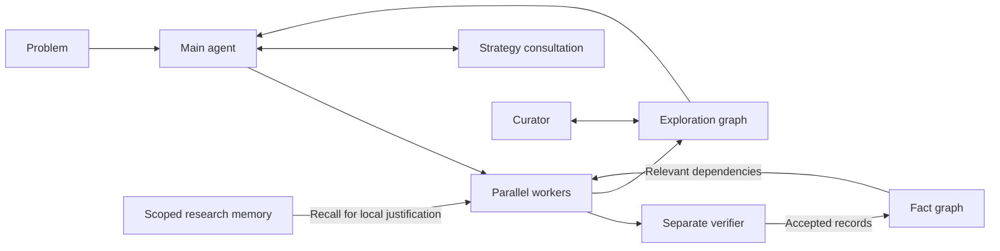

# Ansatz: Continual Graph Memory for Mathematical Research Agents

**Persistent research memory for long-horizon mathematical reasoning.**

Ansatz coordinates a main agent, parallel proof workers, a separate verifier, and a memory curator. It stores accepted proof records with their dependencies, tracks unfinished ideas in an exploration graph, and retrieves earlier research experience to guide subsequent attempts.

This subproject contains the standalone Python implementation, agent contracts and skills, configuration templates, evaluation scripts, examples, and tests. Historical run outputs and research manuscripts are excluded from this source repository. The implementation uses the **`cgm`** package, **`bin/cgm`** command, and **`CGM_*`** environment variables.

This is separate from the website's bounded [`agent_monitor.cgm`](../agent_monitor/cgm/) pipeline. Run the commands below from `cgm-framework/`; use a separate virtual environment for this subproject.

[Quick start](#quick-start) · [Architecture](ARCHITECTURE.md) · [Import notes](docs/release-notes.md) · [Configuration](docs/configuration.md)

## What the system does

- **Preserves proof dependencies.** A content-addressed fact graph records statements, proofs, and predecessors. Dependency traversal provides local proof context and supports revocation of dependent records.
- **Maintains an exploration frontier.** A typed graph connects goals, plans, obstacles, and findings. A curator updates annotations and promising directions as evidence changes.
- **Separates proposal from admission.** Workers propose facts; a separate verifier session reviews them before admission. Role-specific MCP tools constrain how each agent can read or change shared state.
- **Reuses experience with explicit scope.** Cross-project recall can be disabled, limited to the same batch, or enabled across projects. Recalled mathematical statements require local justification before becoming premises.
- **Supports persistent runs.** Project files, assignments, and worker state remain on disk; the CLI and dashboard expose progress across multiple reasoning rounds.



Here, *accepted* means accepted by the configured model-based review process. It does not imply a formal proof-assistant certificate or independent expert validation.

## Quick start

### Inspect the code without a model account

Use **Python 3.10 or later**. From the extracted repository root, the following example creates a local project and assignment, then inspects its state. It needs no third-party Python packages and launches no model calls.

```bash
python3 -m cgm.orchestration --help

(
  demo_dir="$(mktemp -d)"
  export CGM_AGENTS_ROOT="$demo_dir/projects"
  export CGM_CONSULT_TRANSPORT=off

  bash bin/cgm new demo --roles high:1
  cp examples/project/PROBLEM.md "$CGM_AGENTS_ROOT/demo/PROBLEM.md"
  bash bin/cgm assign demo/high --task 'Read PROBLEM.md and plan a proof.'
  bash bin/cgm status demo --json
  bash bin/cgm list --json
)
```

The worker should remain in the `created` state, with no live process and zero completed rounds. The files under [examples/project/](examples/project/fact_graph/README.md) are illustrative hand-authored data, not a recorded proof-search result.

### Configure a live research run

The bundled deployment scripts target **Linux**. They require Python 3.10+, Bash, `curl`, `tar`, and Git. The resident main agent and curator also need `tmux` and an installed, authenticated Claude Code CLI. Worker and verifier sessions require a configured Codex backend; strategy consultation uses the transport selected in your configuration.

1. Provision the local runtime and copy the configuration templates:

   ```bash
   bash scripts/bootstrap.sh
   cp config/cgm.env.example config/cgm.env
   cp config/codex.env.example config/codex.env
   ```

2. Fill in your backend credentials, model identifiers, and consultation settings. Set up the selected backend using the commands in [Getting started](docs/getting-started.md). Credentials belong in the ignored `config/*.env` files.

3. Start verification and check the deployment:

   ```bash
   bash scripts/services.sh up verify
   bash scripts/doctor.sh
   ```

   Bootstrap downloads dependencies. The health check can contact the configured model backend. These commands belong to live deployment, not the offline example above.

4. Open the main-agent session from the repository root:

   ```bash
   claude
   ```

   Follow the initialization workflow, supply the problem statement, and choose worker roles and stop conditions. After the project exists, start its curator with `bash examples/ops/curator-tmux.sh <project_name>`. See the [operating guide](docs/operating-guide.md) for the complete workflow and [operations](docs/operations.md) for service management.

LaTeX and a headless browser are optional output dependencies for paper and progress-report rendering. They are unnecessary for the offline scaffold example.

### Important configuration switches

| Setting | Purpose |
| --- | --- |
| `CGM_CODEX_MODEL`, `CGM_CODEX_EFFORT` | Default model and reasoning effort for worker/verifier launchers; service-specific overrides are available. |
| `CGM_CONSULT_TRANSPORT` | Selects `gpt_pro`, `claude_api`, `claude_code`, or `off`. |
| `CGM_MEMORY_SCOPE` | `off` by default; `batch` restricts recall to matching batch labels; `all` enables cross-project recall. |
| `CGM_AGENTS_ROOT` | Directory containing project state. |
| `VERIFY_PORT`, `DASHBOARD_PORT` | Local verifier and dashboard ports; defaults are 8091 and 8099. |

Configuration defaults are deployment examples, not a declaration of the settings used for every reported experiment. See [configuration](docs/configuration.md) and [security and trust](docs/security-and-trust.md).

## Repository guide

| Path | Contents |
| --- | --- |
| [`cgm/`](cgm/) | Memory stores, MCP gateway, verification, orchestration, execution, strategy, dashboard, and document utilities. |
| [`agents/`](agents/) | Role contracts and worker/verifier skills. |
| [`.claude/skills/`](.claude/skills/) | Main-agent workflows. |
| [`bin/`](bin/) and [`scripts/`](scripts/) | CLI wrappers, deployment, and service management. |
| [`config/`](config/) | Configuration templates with placeholders. |
| [`examples/`](examples/README.md) | Toy project and operational examples. |
| [`experiments/`](experiments/README.md) | Evaluation scripts, runbooks, and prompt inputs; generated results are excluded. |
| [`docs/`](docs/) | Architecture, usage, configuration, and release notes. |

## Development

Install the development extras in your own virtual environment, then run the existing tests:

```bash
python3 -m venv .venv
source .venv/bin/activate
python -m pip install -e '.[dev]'
python -m pytest cgm/ -q
```

The test suite checks software behavior using local fixtures and mocked transports. It does not prove the mathematical claims or reproduce the paper's benchmark. See [import notes](docs/release-notes.md) for the source boundary and validation commands.

## Source and license

The standalone framework was imported from the supplied
`continual-graph-memory-main` release. Code, contracts, skills, and example data
retain their original form; packaging documentation describes this repository.
The code retains its [Apache 2.0 license](LICENSE) and existing copyright notice.
See the repository-wide [attribution](../ATTRIBUTION.md).
